# Atlas · catálogo de escenas y cómo escribir un vídeo

Un vídeo Atlas es un **storyboard JSON** (esquema exacto: `remotion/atlas/schema.ts`). Ningún texto, cifra,
coordenada o color de un vídeo vive en el código: un vídeo nuevo es un storyboard nuevo más sus datos geográficos.

## El camino corto: guion + escenas → vídeo

```
materiales/<carpeta>/
  guion.txt      el texto de la voz, tal cual se dice
  voz.mp3        la voz grabada (opcional: sin ella sale un borrador mudo con tiempos estimados)
  escenas.md     qué debe salir en pantalla, escena a escena, en texto libre   ← la IA escribe el storyboard
  escenas.json   o el storyboard ya escrito: {"storyboard": {...}, "data": [...]}
```

```
python main.py --atlas-guion <carpeta>                      # todo: storyboard, datos, hoja de contactos, render
python main.py --atlas-guion <carpeta> --atlas-hasta stills # revisar la hoja de contactos antes de renderizar
```

Sale `storyboards/<carpeta>.json`, `out/stills/<carpeta>/contact-sheet.jpg` y `out/<carpeta>/atlas.mp4`.
Con `escenas.md` hace falta `LLM_API_KEY` (DeepSeek, como el resto del pipeline); con voz, `OPENAI_API_KEY` (Whisper).
`escenas.md` puede ser tan concreto como quieras: «a las palabras *dos veces la Antártida*, el marco discontinuo
"2 × ANTARCTICA" sobre la barra del Tíbet». La IA sólo puede usar cifras, fechas y nombres que estén en el guion o en
`escenas.md`.

Comandos sueltos: `npm run atlas:validate <sb.json>`, `npm run atlas:stills -- <sb.json> [--at 12.5,30]`,
`npm run atlas:render -- out.mp4 --props=<sb.json> --gl=swangle`, `npm run atlas:compare -- …`.

## Reglas comunes

**Tiempos** (`At`): `{"say": "frase literal del guion", "nth": 2, "offset": -0.2}` (ancla a la voz: se resuelve con la
transcripción; falla si la frase no aparece o se repite sin `nth`) o `{"t": 12.5}` (segundos desde el inicio).
Cada escena empieza en su `start` y acaba cuando empieza la siguiente.

**Campos de toda escena**: `id`, `type`, `start`, `theme` (`"paper"` | `"night"`), `enter` (`"fade"`, o `"continuous"`
para heredar la cámara de la escena anterior del mismo mapa/bloque), `chapter` (índice en `meta.chapters`: activa el
indicador I–V), `kicker` (antetítulo mono), `title` (texto con la palabra clave entre `*asteriscos*`, o
`{"text": "...", "accent": "data"}`), `sourceNote` (nota al pie: fuente, "ILLUSTRATIVE"), `overlays`, `sources`.

**Acentos**: `danger` (rojo; ámbar de noche), `data` (azul), `good` (verde), `amber`, `ink` (tinta).

**Storyboard**:
```json
{
  "meta": { "slug": "mi-video", "title": "…", "brand": { "name": "ATLAS", "icon": "✦" },
            "chapters": [{ "numeral": "I", "label": "Ground" }], "duration": 120 },
  "audio": { "voice": "atlas-work/mi-video/voz.mp3", "transcript": "atlas-work/mi-video/transcript.json" },
  "scenes": [ … ]
}
```
(`voice`, `transcript` y `duration` los pone `--atlas-guion`; rutas relativas a `public/`.)

## Superposiciones (`overlays` de cualquier escena)

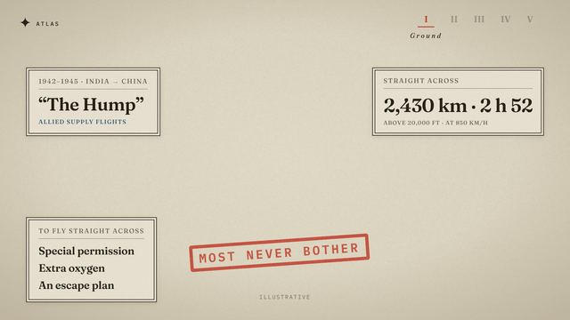

```json
{ "kind": "info-card", "corner": "tl", "at": {"say": "in 1942"}, "kicker": "1942–1945 · India → China",
  "title": "“The Hump”", "sub": "ALLIED SUPPLY FLIGHTS",
  "lines": [{ "text": "Special permission", "at": {"say": "permission"} }] }
{ "kind": "stamp", "at": {"say": "most never bother"}, "text": "MOST NEVER BOTHER", "x": 0.5, "y": 0.8 }
{ "kind": "counter", "corner": "tr", "at": {"t": 3}, "kicker": "STRAIGHT ACROSS", "sub": "AT 850 KM/H",
  "steps": [{ "value": "450 km · 0 h 32", "at": {"t": 3.4} }, { "value": "1,440 km · 1 h 42", "at": {"t": 5} }] }
{ "kind": "legend", "corner": "bl", "at": {"t": 2}, "sub": "SIMPLIFIED",
  "items": [{ "style": "dashed", "accent": "ink", "label": "Shortest path" }] }
```
Con `title`, las `lines` de una info-card van en versalitas pequeñas; sin `title` (`""`), son una lista grande.
El contador anima cada número del texto y acaba en el texto exacto.

## Texto y estructura

### atlas-chapter-card
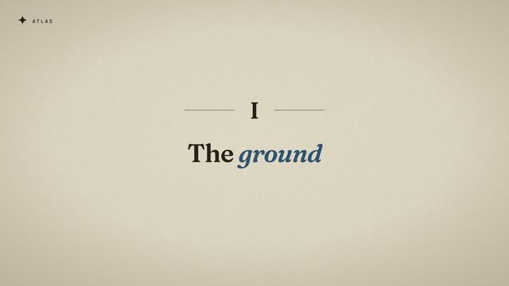
```json
{ "type": "atlas-chapter-card", "of": 0, "title": "The *ground*" }
```

### atlas-agenda

```json
{ "type": "atlas-agenda", "title": "Five reasons", "numerals": [{"t":0.6},{"t":0.9},{"t":1.2},{"t":1.5},{"t":1.8}],
  "tagline": { "text": "Flying across is the easy part.", "at": {"t": 2.3} },
  "notes": [{ "text": "EACH ONE: WHAT IF SOMETHING GOES WRONG?", "accent": "danger", "at": {"t": 3} }] }
```
`numerals`: un momento por capítulo de `meta.chapters`.

### atlas-title-overlay

```json
{ "type": "atlas-title-overlay", "enter": "continuous", "backdrop": "previous",
  "title": "Why do planes avoid *flying over Tibet?*", "titleAt": {"say": "why do planes"} }
```

### atlas-statement
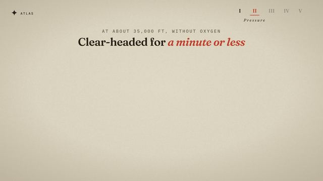
```json
{ "type": "atlas-statement", "kicker": "AT ABOUT 35,000 FT, WITHOUT OXYGEN", "title": "Clear-headed for *a minute or less*" }
```

### atlas-card-row
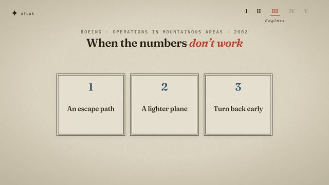
```json
{ "type": "atlas-card-row", "kicker": "BOEING · 2002", "title": "When the numbers *don’t work*",
  "cards": [{ "heading": "1", "text": "An escape path", "at": {"say": "escape path"} }] }
```

### atlas-checklist

```json
{ "type": "atlas-checklist", "title": "Add it *all up*",
  "items": [{ "text": "Satellite links", "sub": "TO TALK TO CONTROLLERS ANYWHERE", "at": {"say": "satellite"} }] }
```

### atlas-recap
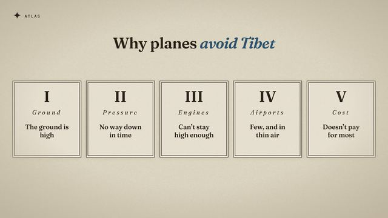
```json
{ "type": "atlas-recap", "title": "Why planes *avoid Tibet*", "items": [{ "text": "The ground is high", "at": {"t": 0.5} }] }
```
Una tarjeta por capítulo, en orden.

### atlas-cta

```json
{ "type": "atlas-cta", "layout": "card", "title": "The world, through *maps*",
  "button": { "label": "SUBSCRIBE", "doneLabel": "SUBSCRIBED", "clickAt": {"t": 2} } }
```
`layout: "stack"` = tarjeta arriba y botón debajo (cierre); con `"backdrop": "previous"` va sobre la escena anterior.

## Gráficos

### atlas-dial
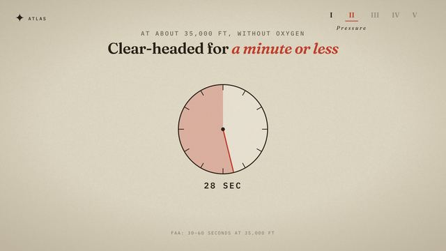
```json
{ "type": "atlas-dial", "dial": { "max": 60, "from": 0, "to": 60, "at": {"t": 0.6}, "seconds": 5, "fill": "remaining", "accent": "danger" },
  "readout": { "text": "{value} SEC", "style": "mono" } }
```
`fill: "elapsed"` + `readout: {"text": {"text": "~{value} *minutes saved*", "accent": "good"}, "style": "serif"}` para ahorro.

### atlas-bar-compare
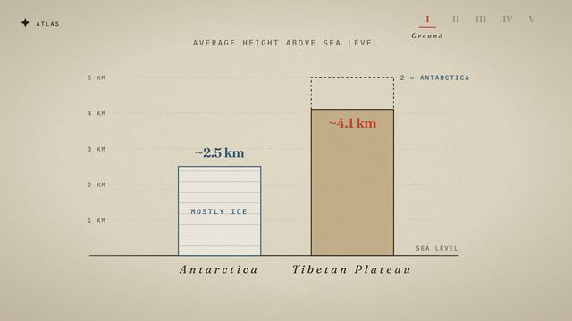
```json
{ "type": "atlas-bar-compare", "axis": { "max": 5, "step": 1, "format": "{v} KM", "style": "grid", "base": "SEA LEVEL" },
  "labels": "below",
  "bars": [{ "label": "Antarctica", "value": 2.5, "display": "~2.5 km", "at": {"t": 1}, "style": "hatched", "valueAccent": "data", "inside": "MOSTLY ICE" },
           { "label": "Tibetan Plateau", "value": 4.1, "display": "~4.1 km", "at": {"t": 2}, "style": "earth", "valueAccent": "danger" }],
  "ghost": { "bar": 1, "value": 5, "label": "2 × ANTARCTICA", "at": {"t": 3} } }
```
También `labels: "above"` (nombre y cifra encima), `axis.style: "ticks"`, `threshold {value,label,at,accent,band}` y
`side {kicker, items, at}`.

### atlas-dot-density
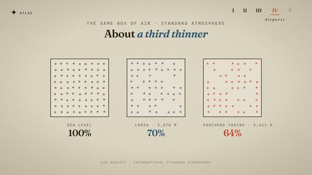
```json
{ "type": "atlas-dot-density", "grid": 9,
  "boxes": [{ "label": "SEA LEVEL", "percent": 100, "display": "100%", "at": {"t": 0.5} },
            { "label": "LHASA · 3,570 M", "percent": 70, "display": "70%", "at": {"t": 1.4}, "accent": "data" }] }
```

### atlas-runway-compare
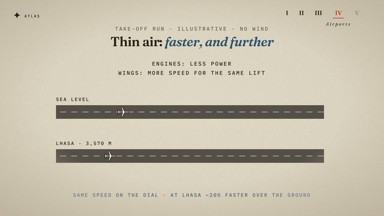
```json
{ "type": "atlas-runway-compare", "notes": [{ "text": "ENGINES: LESS POWER", "at": {"t": 0.6} }],
  "runways": [{ "label": "SEA LEVEL", "liftoff": 0.46, "at": {"t": 1.8}, "seconds": 2.4, "liftoffLabel": "LIFT-OFF" }],
  "footer": { "text": "AT LHASA ~20% FASTER OVER THE GROUND", "at": {"t": 2.5} } }
```

### atlas-elevation-profile
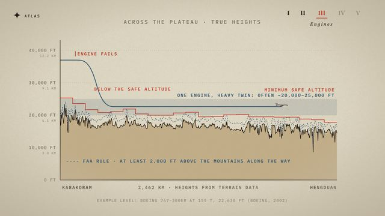
```json
{ "type": "atlas-elevation-profile", "profile": "atlas-data/profiles/karakoram-hengduan.json",
  "axis": { "maxFt": 40000, "stepFt": 10000, "km": true },
  "ends": { "left": "KARAKORAM", "right": "HENGDUAN", "middle": "{km} KM · HEIGHTS FROM TERRAIN DATA" },
  "ground": "terrain",
  "msa": { "at": {"t": 0.2}, "label": "MINIMUM SAFE ALTITUDE", "segmentKm": 110, "marginFt": 2000 },
  "flight": { "points": [{ "x": 0, "ft": 37000 }, { "x": 0.06, "ft": 37000, "curve": "linear" }, { "x": 0.2, "ft": 22630 }],
              "at": {"t": 1}, "drawSeconds": 3, "accent": "data", "stopAtMsa": false },
  "bands": [{ "fromFt": 20000, "toFt": 25000, "label": "ONE ENGINE: ~20,000–25,000 FT", "at": {"t": 2.6} }],
  "violations": { "at": {"t": 4.5}, "label": "BELOW THE SAFE ALTITUDE" } }
```
Más: `ground: "sea"` + `swap {to, at}` (mar → terreno en vivo), `thresholds`, `clearance {ft,label,at}`,
`markers {x,label,at,accent,line}`, `notes {text,x,ft,at}`. `{km}` = distancia real del perfil.
Datos: `{"kind": "profile", "id": "…", "from": [lon,lat], "to": [lon,lat]}`.

## Mapas

### atlas-relief-map
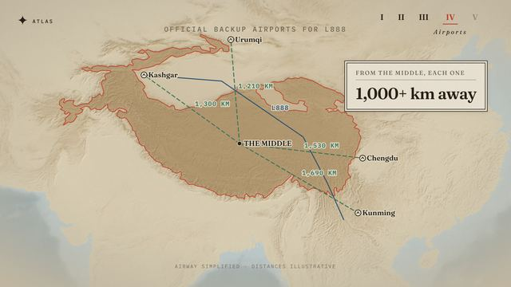
```json
{ "type": "atlas-relief-map", "region": "tibet", "kicker": "OFFICIAL BACKUP AIRPORTS FOR L888",
  "camera": [{ "at": {"t": 0}, "center": [91, 33], "zoom": 1.85 }, { "at": {"say": "zoom in"}, "center": [98, 28], "zoom": 3 }],
  "shapes": [{ "id": "plateau", "source": "atlas-data/regions/tibet/contour-3000.geojson", "at": {"t": 0.6},
               "stroke": "danger", "fill": true, "label": "Tibetan Plateau", "sub": "Land above 3,000 m" },
             { "id": "greenland", "source": "atlas-data/shapes/greenland.geojson", "at": {"t": 5}, "moveTo": [88, 33.5],
               "label": "Greenland, moved here", "sub": "at the same scale" }],
  "routes": [{ "id": "r1", "path": [[89, 33], [104.07, 30.66]], "at": {"t": 2}, "drawSeconds": 1, "style": "dashed",
               "accent": "good", "label": "1,530 KM", "greatCircle": true, "icon": "plane" }],
  "points": [{ "name": "Chengdu", "pos": [104.07, 30.66], "at": {"t": 1}, "marker": "airport" }],
  "labels": [{ "text": "India", "pos": [86, 24], "at": {"t": 1}, "style": "region" }],
  "arrows": [{ "from": [94.5, 28.8], "to": [96.6, 28.9], "at": {"t": 3}, "accent": "data" }] }
```
`zoom 1` = la región entera cubre el cuadro. `moveTo` mueve una silueta por la esfera: tamaño real.
`marker`: `city` | `airport` | `event`. `style` de ruta: `solid` | `dashed` | `dotted`.
Datos: `region` (bbox, proyección), `contour` (metros), `country` (silueta).

### Rejilla de 1°×1° (`graticule` de atlas-relief-map)
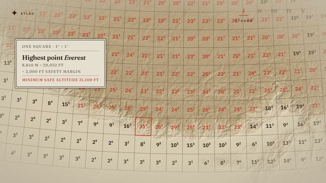
```json
"graticule": { "at": {"t": 0.3}, "cells": "atlas-data/cells/tibet-plateau.json", "marginFt": 2000, "numbersAt": {"t": 3},
               "threshold": { "value": 20000, "at": {"t": 3.2}, "fill": true }, "highlight": [86.925, 27.988] }
```
Cada celda: punto más alto + margen, redondeado a 100 ft (31¹ = 31.100 ft). Datos:
`{"kind": "cells", "id": "…", "bbox": [lonMin, latMin, lonMax, latMax], "peaks": "scripts/atlas-data/peaks/….json"}`.

### atlas-globe
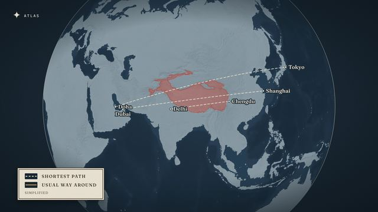
```json
{ "type": "atlas-globe", "theme": "night",
  "camera": [{ "at": {"t": 0}, "center": [84, 30], "zoom": 1.7 }],
  "shapes": [{ "id": "tibet", "source": "atlas-data/regions/tibet/contour-3000.geojson", "at": {"t": 0.5}, "fill": true }],
  "routes": [{ "id": "doha-tokyo", "path": [[51.53, 25.29], [139.78, 35.55]], "at": {"t": 2}, "drawSeconds": 1.5, "style": "dashed", "accent": "ink" }],
  "points": [{ "name": "Tokyo", "pos": [139.78, 35.55], "at": {"t": 1.7}, "marker": "city" }] }
```
`zoom 1` = el globo entero; 3 ≈ un continente llena la pantalla. Las rutas siguen el círculo máximo.

## 3D

### atlas-terrain-3d
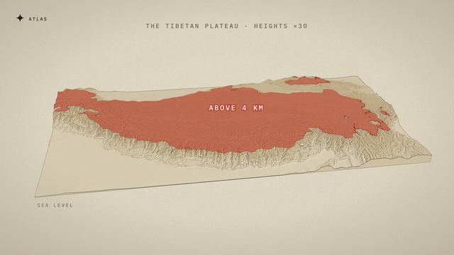
```json
{ "type": "atlas-terrain-3d", "terrain": "tibet-3d", "exaggeration": 30, "kicker": "THE TIBETAN PLATEAU · HEIGHTS ×30",
  "extrude": { "at": {"t": 0.3}, "seconds": 2.2 },
  "camera": [{ "at": {"t": 0}, "tilt": 89, "yaw": 0, "distance": 1.6 }, { "at": {"t": 0.3}, "tilt": 30, "yaw": -12, "distance": 1.5 }],
  "threshold": { "m": 4000, "at": {"t": 3}, "label": "Above 4 km", "labelPos": [89, 33.5] },
  "labels": [{ "text": "Himalayas", "pos": [83.5, 29.2], "at": {"t": 4}, "style": "range" },
             { "text": "Everest", "pos": [86.925, 27.988], "at": {"t": 5}, "style": "peak" }],
  "base": { "label": "Sea level", "at": {"t": 2.5} } }
```
Más: `cruise {km, label, at}`, `plane {from, to, km, at, seconds, dropLine, trail}`, `axis {maxKm, stepKm, at}`,
label `style: "value"` (cifra junto a una cumbre). `tilt` 90 = cenital; `distance` en múltiplos del lado del bloque.
Datos: `{"kind": "terrain", "id": "…", "bbox": [...], "cols": 400, "zoom": 8, "contourStep": 1000, "smooth": 2}`
(`exaggeration` 1 = escala real; con 20-30 usa `smooth` 2-3).

## Vuelos reales (accidentes aéreos)

Todo sale de `accidentes/<caso>/vuelo.json`, que genera `scripts/accidentes/vuelo.py` desde la tabla del FDR de un
expediente oficial (NTSB…) y el caso `scripts/accidentes/casos/<caso>.json` (fuente, corrección de altitud y hechos
con su página). Datos: `{"kind": "flight", "case": "us1549", "table": "<URL de la tabla del FDR>"}`. Nunca escribas
posiciones, altitudes ni velocidades a mano: las escenas las leen de los datos en cada fotograma.

Un vuelo se reproduce con `"flight": {"data": "accidentes/<caso>/vuelo.json", "at": …, "from": "15:25:00", "to":
"15:30:42", "rate": 30}`: desde `at`, el reloj del vuelo corre de `from` a `to` a `rate` segundos de vuelo por segundo
de vídeo (1 = tiempo real) y se queda en `to`. Elige `rate` ≈ (to − from) / segundos que dura la frase. Los hitos
(`marks: [{"clock", "label", "sub", "accent"}]`) aparecen cuando el reloj llega a su hora. Las horas son las del
informe (hora local).

### Trayectoria en el mapa (`flight` de atlas-relief-map)
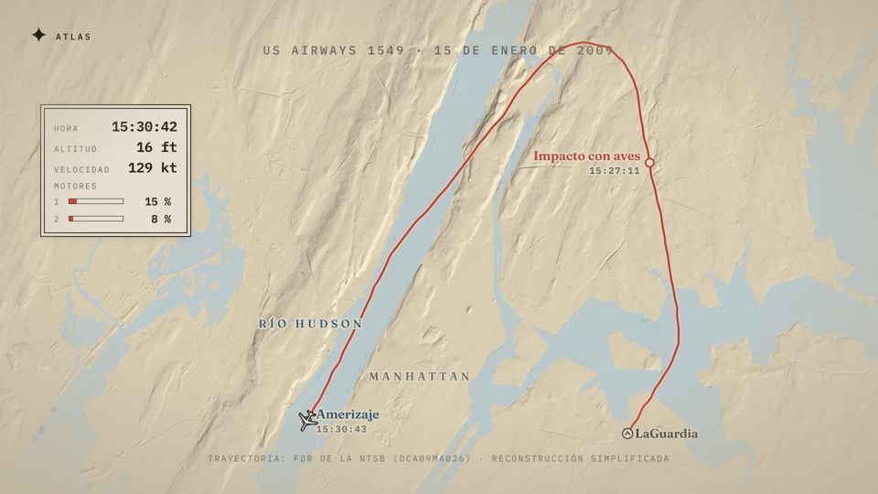
```json
"flight": { "data": "accidentes/us1549/vuelo.json", "at": {"say": "así que gira"}, "from": "15:25:00", "to": "15:30:42",
            "rate": 30, "trail": "flown", "follow": false,
            "marks": [{ "clock": "15:27:11", "label": "Aves", "sub": "15:27:11", "accent": "danger" }],
            "hud": { "show": ["clock", "alt", "kias", "n1"], "corner": "tl" } }
```
`trail`: `flown` (la estela crece) o `full` (el vuelo entero en tenue debajo). `follow`: la cámara sigue al avión.
`hud`: instrumentos leídos de los datos (hora, altitud, velocidad, N1 de los motores como barras).
Región de ciudad: `{"kind": "region", …, "projection": {"type": "mercator"}, "zoom": 14, "margin": 0.03,
"water": {"seas": true, "riversBelowM": 1.0}}` (costa de OSM; los ríos conectados al mar por altura).

### atlas-flight-profile
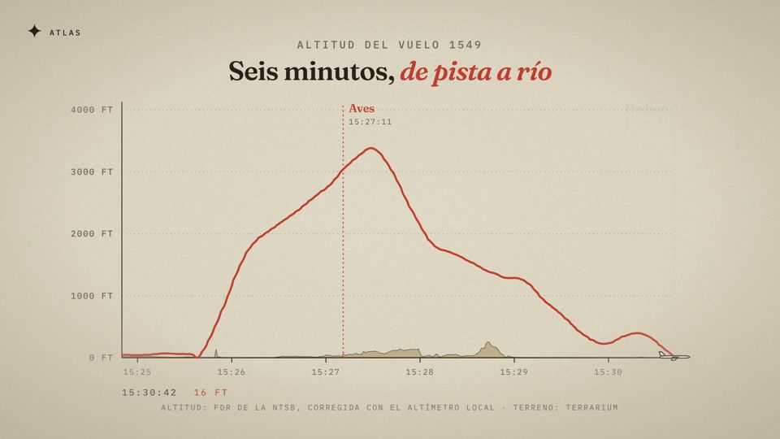
```json
{ "type": "atlas-flight-profile", "kicker": "ALTITUD", "title": {"text": "Tres minutos, *hasta el agua*"},
  "flight": { "data": "accidentes/us1549/vuelo.json", "at": {"say": "en tres minutos"}, "from": "15:25:00", "to": "15:30:42", "rate": 60 },
  "series": "alt", "axis": { "max": 4000, "step": 1000, "unit": "FT" }, "terrain": true,
  "marks": [{ "clock": "15:27:11", "label": "Aves" }],
  "refs": [{ "value": 300, "label": "300 KT: VELOCIDAD PARA REENCENDER", "at": {"t": 1}, "accent": "danger" }] }
```
`series`: `alt` (ft, con `terrain`: el suelo bajo la trayectoria), `kias` (kt) o `n1` (los dos motores; `legend`:
`["MOTOR 1", "MOTOR 2"]`). `refs` = líneas horizontales con su fuente en `sourceNote`.

### Vuelo en 3D (`flight` de atlas-terrain-3d)
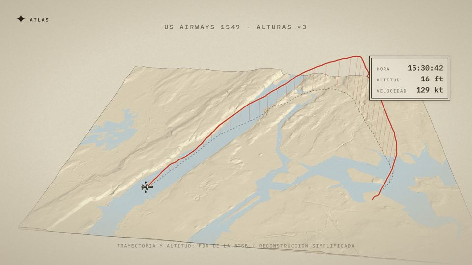
Mismo `flight` que el mapa (sin `trail`/`follow`; `dropLines: false` quita la cortina de líneas al suelo). La altitud
usa la misma `exaggeration` que el terreno. Bloque con la textura de la región (misma agua):
`{"kind": "terrain", "id": "…", "bbox": [...], "cols": 520, "zoom": 14, "contourStep": 1000, "smooth": 1, "region": "nueva-york"}`.

### atlas-cockpit
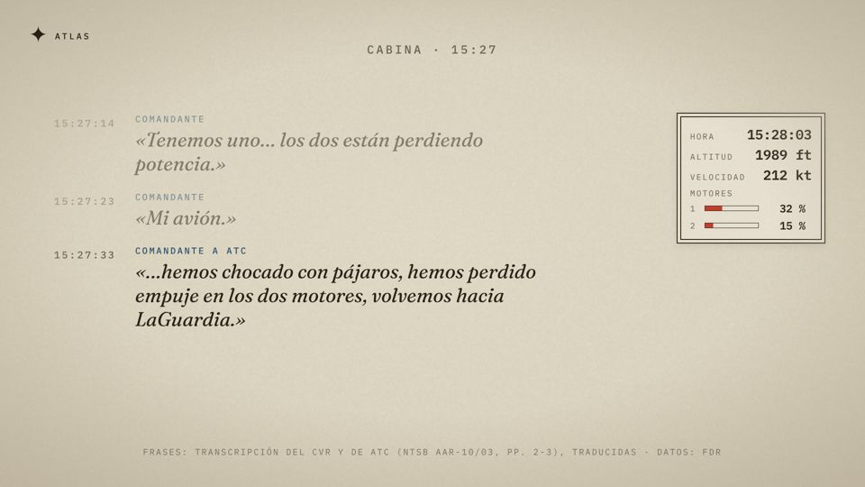
```json
{ "type": "atlas-cockpit", "kicker": "CABINA", "sourceNote": "FRASES: CVR, NTSB AAR-10/03, PP. 2-3 (TRADUCIDAS)",
  "flight": { "data": "accidentes/us1549/vuelo.json", "at": {"say": "en la cabina"}, "from": "15:27:08", "to": "15:28:50", "rate": 4 },
  "instruments": ["alt", "kias", "n1"], "visible": 3,
  "lines": [{ "clock": "15:27:10", "who": "COMANDANTE", "text": "Pájaros.", "ref": "AAR-10/03 p. 2", "accent": "danger" }] }
```
Cada frase, citada del informe (traducida si hace falta) con `ref`; entra cuando el reloj llega a su `clock`.

### atlas-aircraft
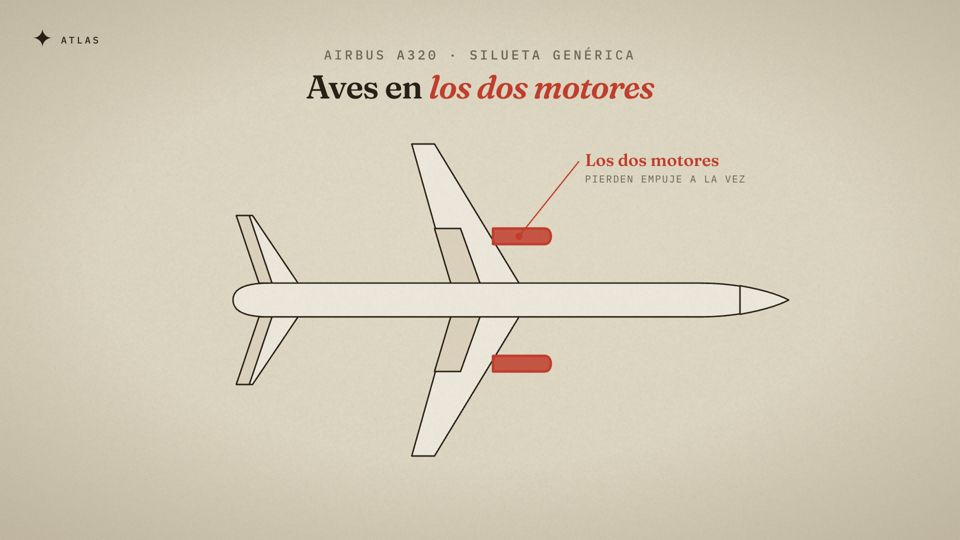
```json
{ "type": "atlas-aircraft", "model": "narrowbody", "view": "top", "kicker": "AIRBUS A320 · SILUETA GENÉRICA",
  "highlights": [{ "part": "engines", "at": {"say": "los dos motores"}, "label": "Los dos motores", "sub": "PIERDEN EMPUJE", "accent": "danger" }] }
```
`model`: `narrowbody` | `bizjet`; `view`: `top` | `side`. `part`: `engines`, `engine-left`, `engine-right`, `wings`,
`flaps`, `tail`, `elevator`, `rudder`, `nose`, `gear`, `fuselage`. Siluetas genéricas: dilo en el `kicker`.

### atlas-known
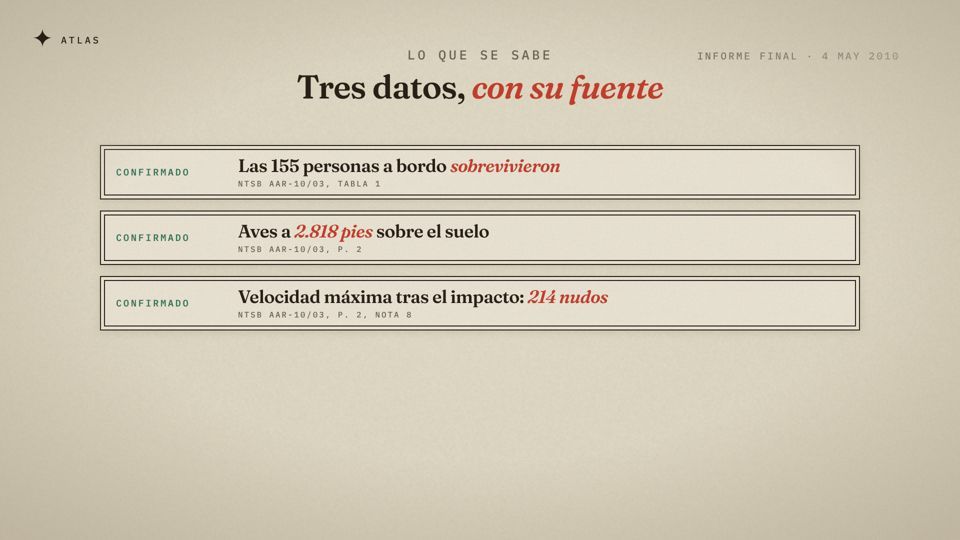
```json
{ "type": "atlas-known", "kicker": "LO QUE SE SABE", "title": {"text": "Tres datos, *con su fuente*"},
  "asOf": "ACTUALIZADO: 15 ENE 2009, 18:00",
  "items": [{ "status": "confirmed", "text": "155 personas a bordo", "source": "NTSB AAR-10/03, TABLA 1", "at": {"t": 1} }] }
```
`status`: `confirmed` | `unconfirmed` | `unknown` (rótulos en `statusLabels` para otros idiomas). Para noticias recientes:
lo no confirmado se dice como tal y nunca se adelanta una causa.

### atlas-flight-cam (de cerca, a escala real)
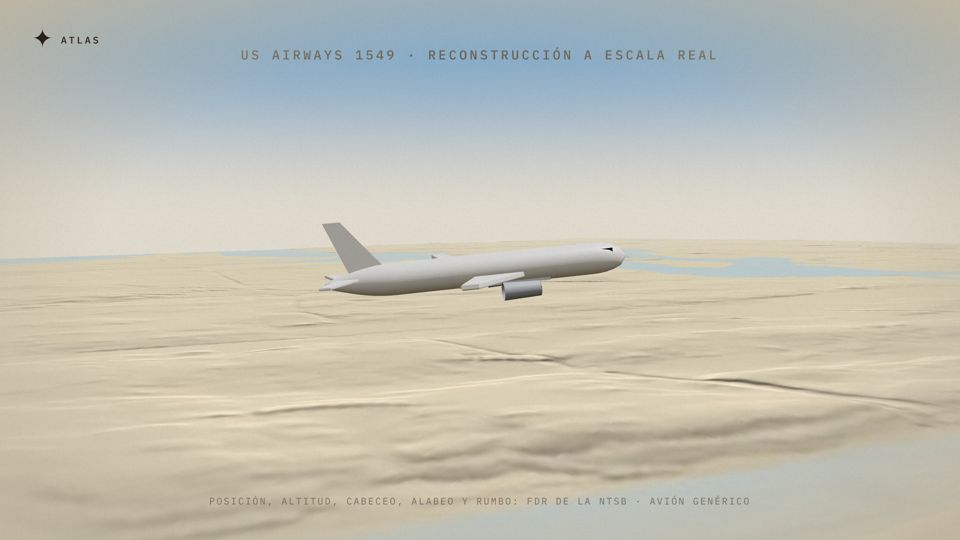 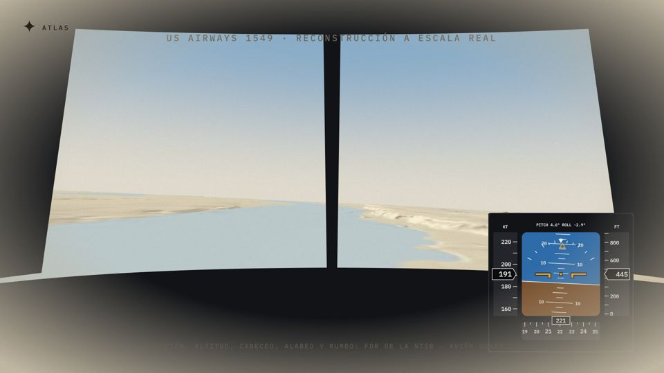
```json
{ "type": "atlas-flight-cam", "terrain": "hudson-cerca", "model": "narrowbody",
  "kicker": "RECONSTRUCCIÓN A ESCALA REAL", "sourceNote": "POSICIÓN, ALTITUD, CABECEO, ALABEO Y RUMBO: FDR · AVIÓN GENÉRICO",
  "flight": { "data": "accidentes/us1549/vuelo.json", "at": {"t": 0}, "from": "15:27:40", "to": "15:30:43", "rate": 6 },
  "camera": [{ "at": {"t": 0}, "mode": "chase", "distanceM": 110, "heightM": 22 },
             { "at": {"say": "en la cabina"}, "mode": "cockpit", "fov": 60 },
             { "at": {"say": "desde la orilla"}, "mode": "ground", "pos": [-74.012, 40.762], "heightM": 3, "fov": 7 }],
  "pfd": { "at": {"say": "en la cabina"}, "corner": "br", "size": 420 }, "cockpitFrame": true }
```
El avión (modelo genérico en código: `narrowbody` | `bizjet`) se mueve con la posición, la altitud, el cabeceo, el
alabeo y el rumbo del FDR a escala real (sin exageración). Cámaras: `chase` (detrás), `side` (`left` para el lado
izquierdo), `orbit` (`degPerSecond`), `ground` (`pos` en el suelo, `fov` pequeño = teleobjetivo) y `cockpit` (desde el
asiento del piloto, el horizonte se inclina con el alabeo; `cockpitFrame` dibuja parabrisas y panel). Cambian en 1,6 s.
`impact: {"clock", "label", "fadeSeconds"}` = a la hora del contacto el avión se desvanece y queda un anillo en el
punto real con el rótulo (informar sin mostrar daños). `pfd` pone el PFD en una esquina; `cockpitPanel: true` añade en la vista cockpit el panel de instrumentos (PFD de los
dos pilotos y N1 de los dos motores en esfera, leídos de los datos).
Personalización: `model` = `narrowbody` (pasillo único) | `widebody` (fuselaje ancho) | `regionaljet` (motores en la
cola, cola en T) | `turboprop` (ala alta, hélices) | `bizjet`; `livery` = `white` | `grey` | `stripe-blue` |
`stripe-red` | `tail-blue` | `tail-red` | `tail-amber` (pinturas genéricas, nunca la de una compañía);
`registration` = la matrícula del informe pintada en el fuselaje («N106US»).
Flaps y tren se mueven solos con el FDR (posición de flaps; tren bajado, recogido o en tránsito).
`engineSound: {"file": "accidentes/<caso>/motores.mp3", "volume": 0.5}` (también en atlas-cockpit y atlas-pfd): el
sonido de los motores sintetizado del N1 (`python3 scripts/accidentes/sonido.py public/accidentes/<caso>/vuelo.json`,
o solo con `{"kind": "flight"}`), sincronizado con el reloj del vuelo; suena natural con `rate` 1.
Decoración real de la compañía (decisión del usuario, que asume el riesgo de marca): `livery` como objeto,
```json
"livery": { "body": "#F2F0EA", "belly": "#3B4F6B", "tail": "#1F3554", "engine": "#3B4F6B", "text": "#1F3554",
            "stripe": "#C8402F", "titles": "NOMBRE DE LA COMPAÑÍA", "titlesColor": "#1F3554",
            "tailLogo": "accidentes/<caso>/livery/cola.png", "titlesLogo": "accidentes/<caso>/livery/logo.png" }
```
Colores en `#RRGGBB` sacados de fotos del avión real; los logos son PNG con fondo transparente que pone el usuario en
`public/accidentes/<caso>/livery/` (el sistema no los descarga). `titles` se pinta delante de las alas. Bloque de terreno grande (que no se vea el borde): `"cols": 800, "zoom": 14` con
`"region"`. Render lento: ~10 s por fotograma en el cloud; úsala en tramos cortos.

### Dónde va el 3D de cerca en un vídeo de accidente
Es lento de renderizar: solo en los momentos fuertes, 5-15 s cada uno, ~60-90 s por cada 10 min de vídeo.

| Momento | Cámara | Encima |
|---|---|---|
| Gancho (primeros 10 s) | `chase` u `orbit` en el momento crítico | nada: que se vea el avión |
| El fallo (aves, motor, aviso) | `chase` o `side` | `pfd` en una esquina |
| La decisión en cabina | `cockpit` + `cockpitPanel` | la voz cita el CVR |
| Aproximación final | `ground` (teleobjetivo) o `side` | `hud` con hora y altitud |
| Desenlace | cualquiera, hasta el contacto, con `impact` | el avión se desvanece en el punto real y queda una marca con la hora; nunca fuego, restos ni víctimas |
| Short | 20-30 s de 3D con `pfd` | `meta.short` |

### atlas-pfd
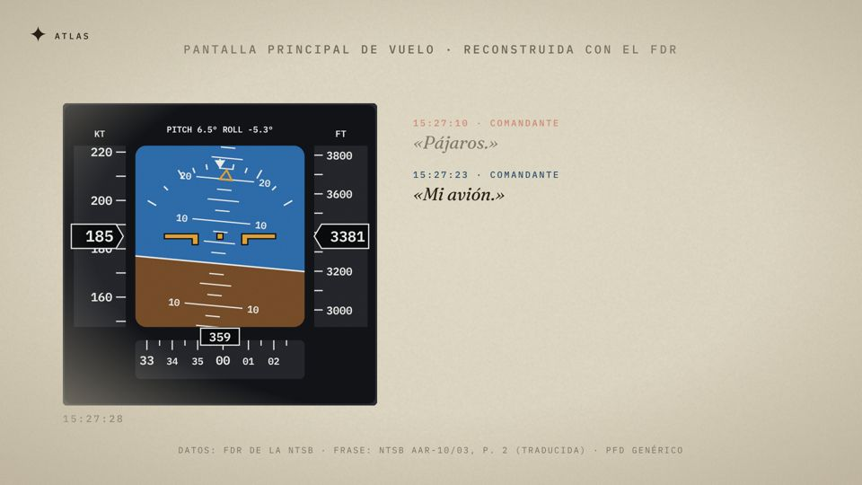
```json
{ "type": "atlas-pfd", "kicker": "PANTALLA PRINCIPAL DE VUELO · RECONSTRUIDA CON EL FDR",
  "flight": { "data": "accidentes/us1549/vuelo.json", "at": {"t": 0}, "from": "15:27:05", "to": "15:27:45", "rate": 5 },
  "lines": [{ "clock": "15:27:10", "who": "COMANDANTE", "text": "Pájaros.", "ref": "AAR-10/03 p. 2" }] }
```
PFD genérico (horizonte artificial, cintas de velocidad y altitud, rumbo magnético) movido por el FDR; `lines`
opcionales a la derecha. Dilo en `sourceNote`: «PFD genérico».

### Versión vertical (Shorts)
`meta.short: {"top": {"text": "El avión que *amerizó en el Hudson*"}, "bottom": "Datos reales del FDR"}` y la
composición `AtlasShort` (1080×1920): el vídeo 16:9 entero en el centro, con el titular arriba y el pie abajo.

## Diagramas

### atlas-diagram
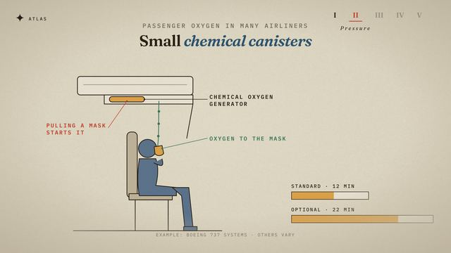
```json
{ "type": "atlas-diagram", "diagram": "atlas-diagrams/plane-twin-top.svg", "box": { "x": 360, "y": 170, "w": 1200, "h": 820 },
  "states": [{ "layer": "engine-top", "at": {"say": "one fails"}, "fill": "danger", "seconds": 0.4 }],
  "callouts": [{ "text": "ONE FAILS", "at": {"say": "one fails"}, "label": [800, 150], "accent": "danger" },
               { "text": "CHEMICAL OXYGEN", "sub": "GENERATOR", "at": {"t": 1}, "anchor": [385, 141], "label": [700, 141] }],
  "meters": [{ "label": "STANDARD · 12 MIN", "at": {"t": 4}, "from": 1, "to": 0, "seconds": 6, "x": 1240, "y": 780, "w": 330 }] }
```
Un estado `{"layer", "at", "opacity", "fill", "stroke", "dashed", "x", "y", "rotate", "scale", "seconds"}` anima la capa
desde su estado anterior (un estado en `{"t": 0}` con `"seconds": 0.01` fija el inicial). `anchor` y `label` en
coordenadas del SVG. Ilustraciones disponibles (capas documentadas al principio de cada archivo):
`seat-oxygen`, `cockpit-top`, `plane-twin-top`, `widebody-cabin`, `cargo-cabin`, `oxygen-bottles`, `plane-side`
(`public/atlas-diagrams/`, generadas por `scripts/atlas-diagrams/build.py`). Un SVG propio sirve igual: clases de
color `ink`, `line`, `paper`, `earth`, `glass`, `body`, `amber`, `grey`, `seat`, `red`.

## atlas-blank
Lienzo vacío (fondo, cabecera y superposiciones): para tarjetas sueltas o pruebas.
